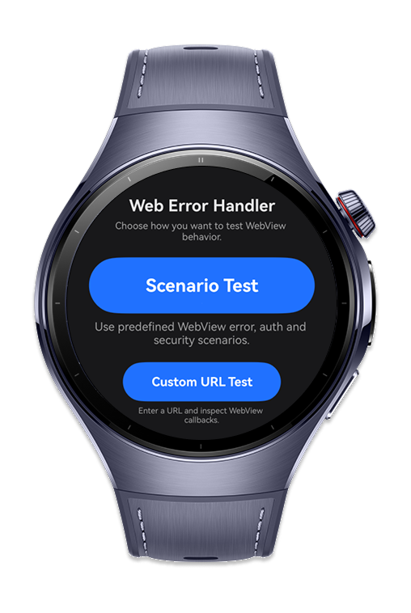
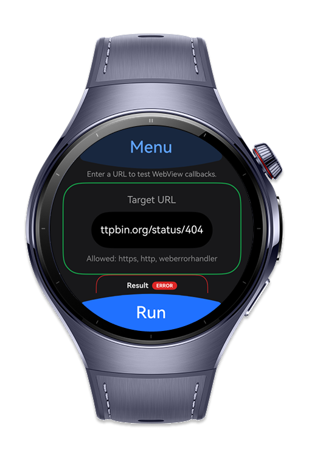
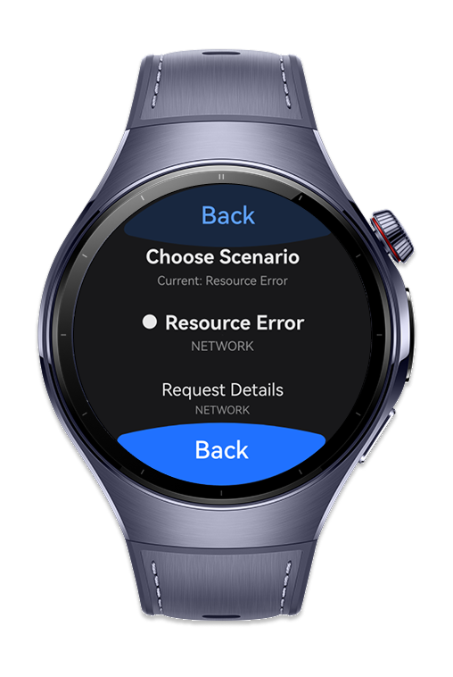
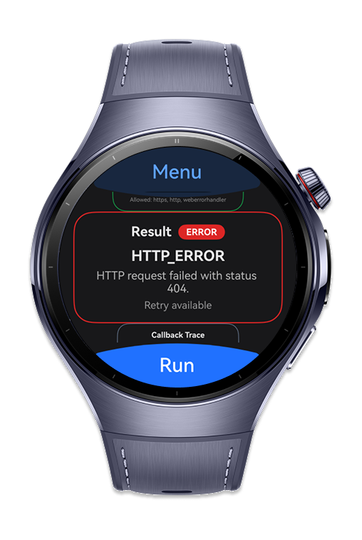

> **Note:** To access all shared projects, get information about environment setup, and view other guides, please visit [Explore-In-HMOS Index](https://github.com/Explore-In-HMOS/hmos-index).

# How to Build Web Status Handler
A wearable web content security layer that uses SslErrorHandler for intercepting SSL certificate errors and prompting the user with trust decisions, HttpAuthHandler for handling HTTP Basic/Digest authentication challenges with credential input, ClientAuthenticationHandler for managing client certificate selection during mutual TLS, WebResourceError for capturing and classifying web resource loading failures, WebResourceRequest for inspecting failed request details (URL, headers, method), and WebResourceHandler for custom handling of resource loading (retry, fallback, cache). The codelab builds a secure web dashboard for enterprise IoT monitoring that handles certificate pinning, authentication, and graceful error recovery.

# Preview
<div>
    
    
    
    
</div>

# Use Cases
## Test a predefined WebView scenario
1. The user opens the Scenario Test page.
2. The user selects one of the predefined scenarios.
3. The user chooses Simulated or Live mode.
4. The user taps Run.
5. The application executes the  selected scenario.
6. The detected WebView callback and corresponding result are displayed on the screen.

## Test a custom URL
1. The user opens the Custom URL Test page.
2. The user enters a URL.
3. The user taps Run.
4. The application loads the URL using the hidden Web component.
5. The application listens for WebView callbacks.
6. The detected callback and its handling result are displayed.

## Handle an SSL certificate error
1. The application detects an SSL certificate error.
2. The SSL prompt is displayed.
3. The user chooses Confirm or Cancel.
4. The selected action is applied through the SslErrorHandler.
5. The final callback result is displayed.

## Handle HTTP authentication
1. The application receives an HTTP authentication request.
2. The authentication prompt is displayed.
3. The user enters credentials or cancels the request.
4. The application processes the selected action.
5. The callback result is displayed.

## Handle client certificate authentication
1. The application receives a client authentication request.
2. The certificate prompt is displayed.
3. The user confirms, cancels, or ignores the request.
4. The application executes the selected action.
5. The callback result is displayed.

## Review callback details
1. The user executes a scenario or custom URL test.
2. The application records the detected callback.
3. The latest callback information is displayed on the result cards.
4. The user opens the event history.
5. The user selects an event to view its detailed information.

# Technology
## Stack
- **Languages**: ArkTS
- **Frameworks**: HarmonyOS SDK 5.1.0(18)
- **Tools**: DevEco Studio Version 6.1.1
- **Libraries**: @kit.PerformanceAnalysisKit, @kit.BasicServicesKit, @kit.ArkWeb, @kit.ArkUI

## Required Permissions
"ohos.permission.INTERNET",

# Directory Structure
```
├───main
  │   module.json5
  │
  ├───ets
  │   ├───components
  │       CallbackTraceCard.ets
  │       CustomUrlInputPanel.ets
  │       EventLogItem.ets
  │       LatestEventCard.ets
  │       PromptPanel.ets
  │       ResultCard.ets
  │       ScenarioListItem.ets
  │       WebCallbackBridge.ets
  │
  ├───constants
  ├───entryability
  │       EntryAbility.ets
  │
  ├───entrybackupability
  │       EntryBackupAbility.ets
  │
  ├───model
  │       ErrorHandlerEvent.ets
  │       ErrorHandlerPrompt.ets
  │       ErrorHandlerScenario.ets
  │       ErrorHandlerUiState.ets
  │
  ├───pages
  │       Index.ets
  │
  ├───service
  │       ErrorHandlerAuthManager.ets
  │       ErrorHandlerCustomUrlService.ets
  │       ErrorHandlerHistoryService.ets
  │       ErrorHandlerLogger.ets
  │       ErrorHandlerNavigationService.ets
  │       ErrorHandlerSchemeManager.ets
  │       ErrorHandlerSchemeResponseFactory.ets
  │       ErrorHandlerWebControllerManager.ets
  │       ErrorHandlerWebManager.ets
  │
  ├───view
  │       CustomUrlTestPage.ets
  │       EventDetailPage.ets
  │       EventHistoryPage.ets
  │       MainMenuPage.ets
  │       ScenarioPickerPage.ets
  │       ScenarioTestPage.ets
  │
  └───viewmodel
          ErrorHandlerNavigationHistoryViewModel.ets
          ErrorHandlerRunViewModel.ets
          ErrorHandlerViewModel.ets 
          ErrorHandlerWebEventViewModel.ets

```
# Constraints and Restrictions
## Supported Devices
- Huawei Watch 5
- DevEco Studio Simulator

# License
How to Build Web Status Handler distributed under the terms of the MIT License
See the [[license]](./LICENSE) for more information.